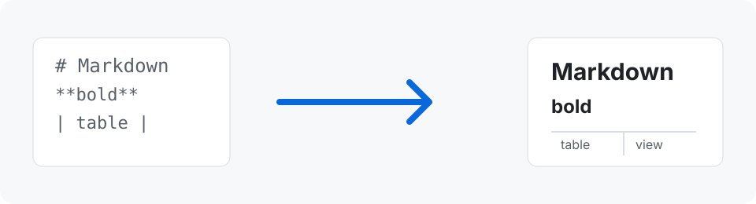
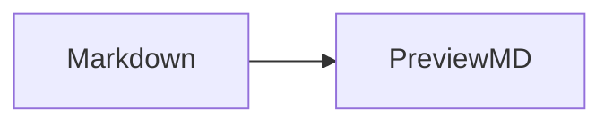

# Markdown render gallery

This file is a visual checklist for PreviewMD. The first part uses syntax that the app currently renders. The last part shows important GitHub-style extensions that are still planned.

---

## Text styles

Regular text can contain **bold**, *italic*, ~~strikethrough~~, and `inline code`.

Use [a named link](https://www.markdownguide.org/) when the destination needs a readable label.

## Image



The image above is loaded from a file next to this Markdown document.

## Lists

Unordered lists:

- First point
- Second point
- Third point

Ordered lists:

1. Read the document
2. Use the Edit button when changes are needed
3. Return to PreviewMD to read the rendered result

## Quote and rule

> Markdown is a writing format. PreviewMD turns that source into a document for reading.

---

## Table alignment

| Left aligned | Center aligned | Right aligned |
| :--- | :---: | ---: |
| Links | **Strong text** | 42 |
| `inline code` | Plain text | 3.14 |

## Code block

```swift
struct Document {
    let name: String
    let editable = false
}
```

---

## GitHub-style extensions to add next

These examples are intentionally shown as source for now, so it is clear which syntax is planned rather than silently falling back to plain text.

````md
- [x] Completed task
- [ ] Remaining task

Here is a footnote reference.[^1]

[^1]: A footnote appears at the end of a document.

> [!NOTE]
> A GitHub alert has a label, colour, and icon.

<details>
<summary>Collapsed details</summary>

This starts hidden and expands on click.
</details>

Inline math: $E = mc^2$


````
