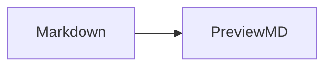

# Markdown render gallery

This file is a visual checklist for PreviewMD. The first part uses syntax that the app currently renders. The last part shows GitHub-style extensions that are outside the current viewer scope.

---

## Text styles

Regular text can contain **bold**, *italic*, ~~strikethrough~~, and `inline code`.

Use [a named link](https://www.markdownguide.org/) when the destination needs a readable label.

## Image


The image above is loaded from a file next to this Markdown document.

## Lists

Unordered lists:

- First point
- Second point
  - Nested point
    - Third level
- Third point

Ordered lists:

3. Read the document
4. Use Open in Editor… when changes are needed
5. Return to PreviewMD to read the rendered result

[Jump to table alignment](#table-alignment) or [open the short demo](formatting-demo.md).

A [reference link][commonmark] and a hard break:\
this starts a new line.

[commonmark]: https://commonmark.org/

## Quote and rule

> Markdown is a writing format. PreviewMD turns that source into a document for reading.

---

## Table alignment

| Left aligned | Center aligned | Right aligned |
| :--- | :---: | ---: |
| Links | **Strong text** | 42 |
| `inline code` | Plain text | 3.14 |

## Code block

```swift
struct Document {
    let name: String
    let editable = false
}
```

---

## Unsupported extended syntax

These examples are intentionally shown as source for now, so it is clear which syntax is unsupported; these examples do not promise future implementation.

````md
- [x] Completed task
- [ ] Remaining task

Here is a footnote reference.[^1]

[^1]: A footnote appears at the end of a document.

> [!NOTE]
> A GitHub alert has a label, colour, and icon.

<details>
<summary>Collapsed details</summary>

This starts hidden and expands on click.
</details>

Inline math: $E = mc^2$


````
